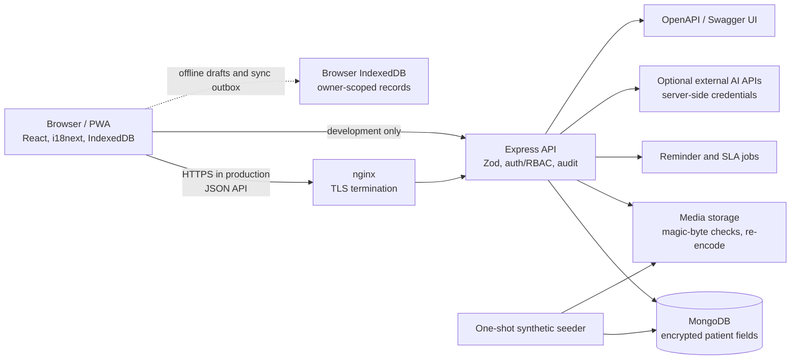

# Architecture overview

All data in this system is synthetic. The application is a hackathon simulation and is **not for clinical use**.

## Request and data boundaries

- The browser stores offline work in owner-scoped IndexedDB and sends it through the authenticated sync API when connected. Replayed operations use client UUIDs for idempotency.
- nginx is the public entry point in the production-like Compose configuration; MongoDB and the API remain on a private Compose network.
- The API validates request bodies, query strings, and identifiers before database operations. Route middleware applies authentication, role checks, care relationships, and audit logging.
- Patient identity fields are encrypted at rest; dashboard/export routes return aggregates. Uploaded media is type-sniffed, bounded, and re-encoded before use.
- AI credentials and other long-lived secrets stay server-side. The demo model is deterministic and has no clinical model weights; its outputs are advisory workflow states only.
- The seed container creates only tagged synthetic demo records and completes before the API is allowed to start.

For production-like deployment, supply TLS files and generated secrets through the environment/secret manager. Do not use real patient information.
